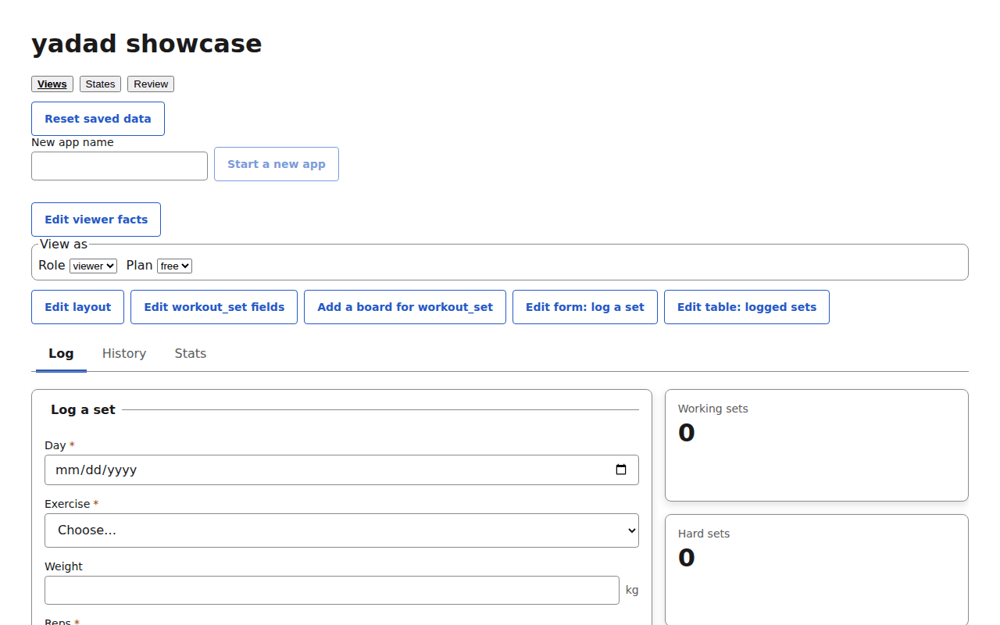
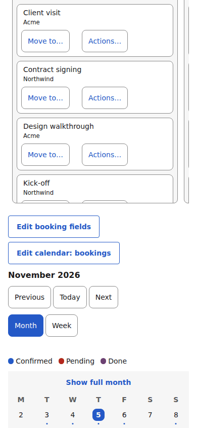
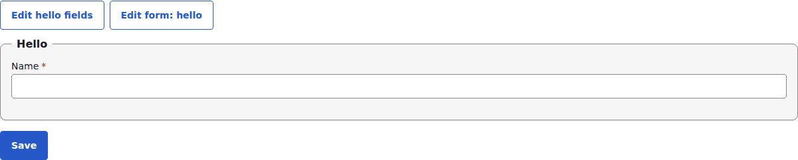
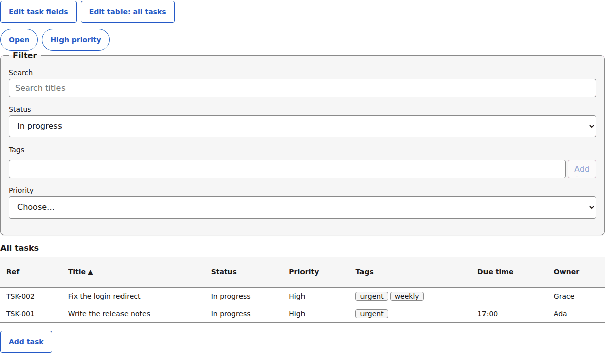
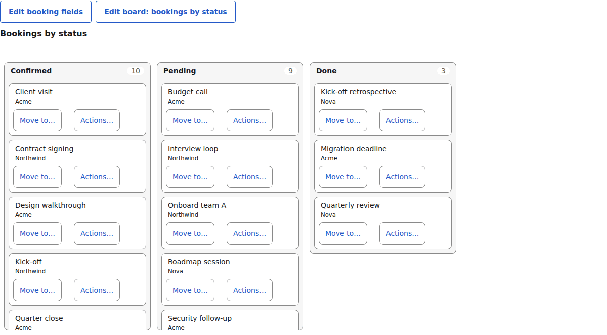
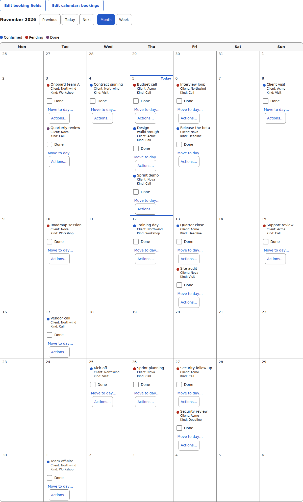
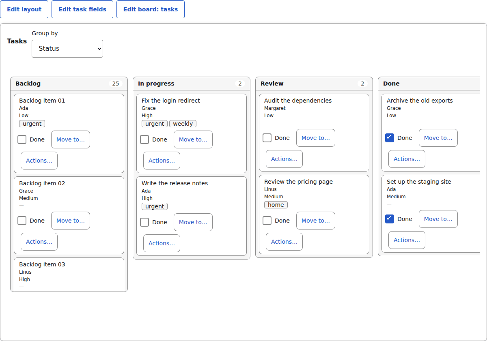
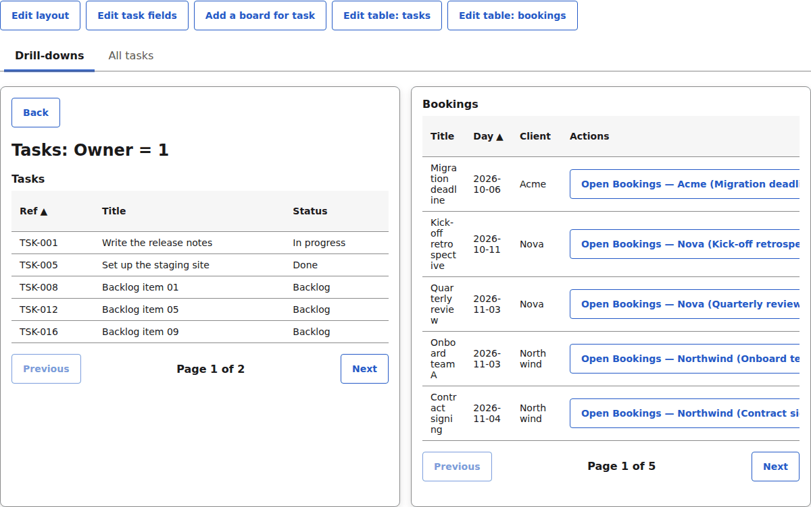
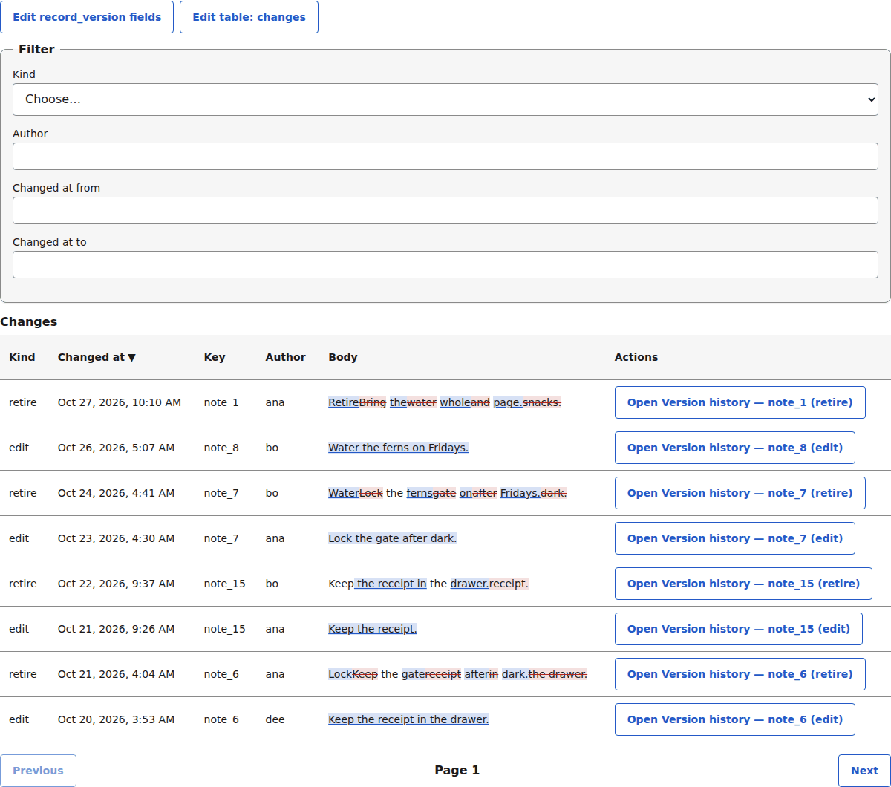

# yadad

Yet another drag and drop: a schema-driven React engine for data-bound apps. You describe an app as small, strictly validated JSON documents (entities that own fields, and views that show them), and a renderer turns those documents plus live records into working forms, record tables, calendars, kanban-style boards and dashboards. Documents can be stored in a database and edited visually, so changing an app needs no redeploy.



*The showcase at laptop width — one generated app: a form, its count widgets, tabs and the editing toolbar, all from documents.* The same page on a phone:



*Same documents, 390 px wide: the chrome adapts, nothing else changes.* Every picture here ships from [docs/assets/screens/](docs/assets/screens/) with the URL, state and command that produced it.

## What you write, what you get

Each section is the smallest document that produces the screen, followed by the screen itself. All of these render against one entity — a task list, in this shape:

```jsonc
{ "kind": "entity", "specVersion": 10, "id": "task", "revision": 1, "fields": [
  { "id": "title", "type": "text", "label": "Title", "required": true },
  { "id": "status", "type": "select", "label": "Status", "options": { "source": "static", "values": ["To do", "In progress", "Done"] } },
  { "id": "owner", "type": "select", "label": "Owner", "options": { "source": "static", "values": ["Ada", "Sam"] } },
  { "id": "priority", "type": "select", "label": "Priority", "options": { "source": "static", "values": ["High", "Low"] } },
  { "id": "due", "type": "date", "label": "Due" } ] }
```

The pictures come from the showcase rendering these documents with the
[`@yadad/components`](https://github.com/aggressive-stag/yadad-components) registry — the links under
each picture go to that component's page.

### A form

```jsonc
{ "kind": "form", "specVersion": 10, "id": "new_task", "entity": "task", "revision": 1, "dataSource": "default",
  "sections": [{ "id": "main", "title": "New task",
    "items": [{ "field": "title" }, { "field": "status" }, { "field": "due" }] }] }
```



*The smallest form document: one section, three fields — labelled inputs, required markers and error frames come from the registry's [FieldFrame](https://github.com/aggressive-stag/yadad-components/blob/main/docs/components/field-frame.md), [Text](https://github.com/aggressive-stag/yadad-components/blob/main/docs/components/text.md), [Select](https://github.com/aggressive-stag/yadad-components/blob/main/docs/components/select.md) and [Date](https://github.com/aggressive-stag/yadad-components/blob/main/docs/components/date.md).* (The picture shows the showcase's `hello_form`, same shape.)

### A table

```jsonc
{ "kind": "table", "specVersion": 10, "id": "tasks_table", "entity": "task", "revision": 1, "dataSource": "tasks",
  "title": "All tasks",
  "columns": [{ "field": "title" }, { "field": "status" }, { "field": "owner" }, { "field": "priority" }],
  "quickFilters": [{ "field": "status" }, { "field": "owner" }],
  "sort": [{ "field": "title", "dir": "asc" }] }
```



*Sortable headers, quick-filter chips, a pager: [the Table component's page](https://github.com/aggressive-stag/yadad-components/blob/main/docs/components/table.md) covers the cell anatomy; sorting and filtering semantics live in the document and adapter, not the component.*

### A board

```jsonc
{ "kind": "board", "specVersion": 10, "id": "tasks_board", "entity": "task", "revision": 1, "dataSource": "tasks",
  "groupBy": [{ "field": "status" }, { "field": "owner" }], "titleField": "title",
  "cardFields": ["owner", "priority"], "editable": true }
```



*One column per value of the picked `groupBy` field; drag a card — or use the keyboard — and the field changes through the adapter. [Board component page](https://github.com/aggressive-stag/yadad-components/blob/main/docs/components/board.md).*

### A calendar

```jsonc
{ "kind": "calendar", "specVersion": 10, "id": "tasks_calendar", "entity": "task", "revision": 1, "dataSource": "tasks",
  "dateField": "due", "titleField": "title", "modes": ["month", "week"], "editable": true }
```



*Records land on the days of their `dateField`; drag an entry to another day to change it. Week mode beside month mode: [Calendar component page](https://github.com/aggressive-stag/yadad-components/blob/main/docs/components/calendar.md).*

### A dashboard

```jsonc
{ "kind": "dashboard", "specVersion": 10, "id": "tasks_home", "title": "Team home", "revision": 1,
  "tabs": [{ "id": "work", "title": "Work", "items": [
    { "id": "board", "x": 0, "y": 0, "w": 12, "h": 10, "widget": "view", "view": "tasks_board" }]}] }
```



*Widgets sit on a 12-column grid (`x, y, w, h`): `view` embeds a form/table/calendar/board, `count` and `stat` show numbers, `series` charts a grouped measure. The editor's layout mode drags and resizes them (from the keyboard too).*

### A drill-down

Any table can open another view bound to the clicked row:

```jsonc
// on tasks_by_owner (a table of tasks):
"rowAction": { "open": "tasks_for_owner", "bind": [{ "field": "owner", "to": "owner" }] }
```



*Click a task and its owner's tasks open beside it, with the drill kept in the URL so a reload restores it. RFC [0003](rfcs/0003-row-drill-down.md) and [0010](rfcs/0010-consumer-feedback-round-3.md) define the contract.*

### A review screen

A review screen is not a special kind: it is a table over a versions entity with a `compare` column and record actions.

```jsonc
// on a versions entity that declares actions: { "id": "apply", "label": "Apply", "confirm": { "message": "Apply this change?" } }
{ "kind": "table", "specVersion": 10, "id": "review_changes", "entity": "record_version", "revision": 1, "dataSource": "review",
  "title": "Changes",
  "columns": [{ "field": "changed_at" }, { "field": "author" }, { "field": "body", "compare": { "field": "previous_body" } }],
  "recordActions": ["apply", "reject"] }
```



*The `compare` column shows what changed as marked-up words; the entity's actions ride each row through [the Dialog component](https://github.com/aggressive-stag/yadad-components/blob/main/docs/components/dialog.md). [RFC 0007](rfcs/0007-review-screens.md) is the contract.*

## What you get

- **Documents as the contract.** Entities, forms, tables, calendars, boards, dashboards and a viewer document are plain JSON with a JSON-Schema-backed validator that reports errors by JSON Pointer, with a hint for each.
- **A headless runtime.** Form state, conditions, record validation and JSON Patch, with no React and no DOM.
- **React renderers** for forms, tables, calendars, boards and dashboards that look every component up in a registry you inject.
- **Boards and calendars.** A board shows records as cards in columns, one per value of a select, boolean or reference field, and a calendar places them on the days of a month or week. Both can move a record by drag or from the keyboard.
- **Who is viewing.** A `viewer` document declares facts about the viewer (a role, a plan); conditions on columns, fields, tabs, widgets and editing read them, and a record can say what the viewer may do with it. What a viewer may not use is not rendered.
- **Visual editors** for fields, form layout, table, calendar and board settings, viewer facts and dashboard grids. Every edit is a JSON Patch with undo/redo, and drag and resize work from the keyboard. A states preview shows the edited view in every state it can be in.
- **Every state, checked.** The runtime lists the states a view can be in (empty, full, hidden fields, a locked record, a role) from its documents, and the test kit renders and checks each one.
- **Data adapters** (memory, key-value, HTTP) with record versions and optimistic concurrency.
- **A theme** of CSS-variable tokens, and a test kit for component sets.

## Quick start

The packages (the engine and `@yadad/components`) are published to the project's GitLab npm registry, not to npmjs.com. Point the `@yadad` scope at the registry's instance-level npm endpoint, `https://<gitlab-host>/api/v4/packages/npm/`, where `<gitlab-host>` is the GitLab instance that hosts the project. One scope entry serves every `@yadad/*` package. Add an auth token for that host if the instance requires one. React 19 is a peer dependency.

```sh
echo "@yadad:registry=https://<gitlab-host>/api/v4/packages/npm/" >> .npmrc
npm install @yadad/core @yadad/runtime @yadad/renderer @yadad/theme @yadad/components react react-dom
```

Or start from [`examples/starter`](examples/starter): a small app made of JSON documents, with a records server, that you copy and change.

Describe an entity and two views, give the renderer a registry and a data adapter, and render:

```tsx
import type { EntityDocument, FormView, TableView } from "@yadad/core";
import { FormRenderer, TableRenderer } from "@yadad/renderer";
import { createMemoryAdapter } from "@yadad/runtime";
import { baseRegistry as registry } from "@yadad/components"; // or `mockRegistry` from "@yadad/testing"
import "@yadad/components/styles.css";
import { useState } from "react";

const entity: EntityDocument = {
  kind: "entity", specVersion: 10, id: "workout_set", revision: 1,
  fields: [
    { id: "day", type: "date", label: "Day", required: true },
    { id: "exercise", type: "select", label: "Exercise", options: { source: "static", values: ["Squat", "Bench press"] } },
    { id: "reps", type: "number", label: "Reps", min: 1, step: 1 },
  ],
};

const form: FormView = {
  kind: "form", specVersion: 10, id: "log_set", entity: "workout_set", revision: 1, dataSource: "default",
  sections: [{ id: "set", title: "Log a set", items: [{ field: "day" }, { field: "exercise" }, { field: "reps" }] }],
};

const table: TableView = {
  kind: "table", specVersion: 10, id: "recent_sets", entity: "workout_set", revision: 1, dataSource: "default",
  title: "Recent sets",
  columns: [{ field: "day" }, { field: "exercise" }, { field: "reps" }],
  filter: { op: "gte", field: "day", value: { daysFromToday: -7 } },
  quickFilters: [{ field: "exercise" }],
};

const dataSources = new Map([["default", createMemoryAdapter()]]);

export function App() {
  const [saved, setSaved] = useState(0);
  return (
    <>
      <FormRenderer entity={entity} view={form} registry={registry} dataSources={dataSources} onSaved={() => setSaved((n) => n + 1)} />
      <TableRenderer entity={entity} view={table} registry={registry} dataSources={dataSources} reloadKey={saved} />
    </>
  );
}
```

Documents that come from a database or a user are untrusted JSON: run them through `validateDocument` from `@yadad/core` first. Emit the theme's CSS variables once, e.g. into a `<style>` tag, with `themeToCss(lightTheme)` from `@yadad/theme`. Swap `createMemoryAdapter()` for `createHttpAdapter({ baseUrl: "/api/records" })` to talk to a backend that speaks the [records protocol](docs/records-protocol.md). This exact sample is compiled and rendered by `apps/showcase/src/readme-quickstart-sample.test.tsx` (with `mockRegistry` standing in for the reference registry) — if the renderers' props change, that test fails and this sample is fixed with it.

A built yadad app makes no requests to yadad infrastructure: all data comes from the `DataAdapter` the host supplies.

Next: [the guide](docs/guide.md) builds a small app with a form, tables, a board, a calendar and a dashboard, one document at a time.

## Tested with

| Tool | Tested in CI | Declared range | Note |
| --- | --- | --- | --- |
| Node | 24 (GitHub: `24`; GitLab: `24.21.0`) | `>=22.18` (root `engines`; the published packages declare none) | The oldest Node is only declared, not run in CI |
| React and `react-dom` | 19.3.0 | `^19.3.0` (peer of renderer, editor, testing) | `core`, `runtime` and `theme` do not use React |
| TypeScript | 6.0.2 (`@typescript/typescript6`) | none | The published packages ship `.d.ts` files built by it; no range is checked for consumers |
| Vite | 8.3.2 | none | Only the showcase and the tests use it; the packages do not depend on a bundler |
| Vitest | 5.0.3 | `^5.0.3` (peer of `@yadad/testing`) | |
| jsdom | 30.1.1 | `~30.1.1` (peer of `@yadad/testing`) | The peer range is narrower than "any jsdom": a newer minor is untested |
| pnpm | 12.9.1 | `packageManager` in the root `package.json` | Consumers can use any package manager |

For tests, a consumer needs `mockRegistry` from `@yadad/testing` and a DOM: jsdom (the peer) or a real browser. Nothing in the packages needs a network. The component set (`@yadad/components`) declares `@yadad/core >=0.10.0 <1.0.0` and `react ^19.3.0` as peers.

## Check every state of your views

A screen is more than the one state you looked at. `viewStates` in `@yadad/runtime` lists the states a view can be in, read from its conditions (a field hidden by `visibleWhen`, no records, many records, a locked record, each role), and `checkViewStates` in `@yadad/testing/state-checks` renders every one with your renderers and reports the ones that throw, log errors, show a field that should be hidden, lack an accessible name or offer an edit the viewer may not make. The editor package has a `StatesPreview` that shows the same states next to a view as you edit it. See [`@yadad/testing`](testing) for a test you can paste.

## Review screens

A review screen (changes, a version history, decisions to act on) is a table, a `datetime` field, a compare column and record actions, all from the documents. Other features, such as `time` and `tags` fields, the batch composer, checklists, saved filters and `fieldEqFact`, are in the [document reference](docs/reference.md).

- **Record actions.** An entity declares what a record can do (`actions`: `apply`, `reject`, `restore`, ... each `id`, `label`, optional `confirm` message (with an optional `subjectField` naming the record in the dialog), optional typed `input` fields, optional `visibleWhen`), and a table, calendar or board offers them per row with `recordActions`. A press runs, or asks first in a dialog built by the renderer and drawn through the registry's `layout.Dialog`. The adapter runs it (`POST .../actions/{action}` with the required `baseVersion`) and the row updates with the record's new `can`. `availableActions` in `@yadad/runtime` answers "may this row offer this action" for the renderer and the editor alike; an action withheld by `visibleWhen` or `can.actions` is not rendered, not greyed out.
- **Datetimes.** A `datetime` field stores one canonical string — UTC, milliseconds, `Z` — so sorting and filtering never parse; cells show the viewer's zone and locale via `formatDateTime`, and a from/to quick filter reads the viewer's clock (a range typed 10:00–10:30 includes 10:30:59.999).
- **What changed.** `compare` on a text column diffs the cell against the previous or next row, or against another text field of the same record — a version history shows the edit as words, marked up by the component (`diff` prop on the text `Display`). The diff is computed in `runtime` and checked by the state grid.
- **Paging without a count.** `Page.total` is optional: a server that answers `next` gets cursor paging with Previous and Next (the table keeps the cursors it visited; "Load more" is rejected), and a count widget walks pages to the 5,000 cap and says "5000+".

The showcase's review page is a worked example: changes, version history with compare, and decisions with apply, reject and restore, every action editable and previewable. See [ARCHITECTURE.md](ARCHITECTURE.md) §6 and Design: [RFC 0007](rfcs/0007-review-screens.md).

## Packages

| Package | What it is |
| --- | --- |
| [`@yadad/core`](packages/core) | Document types, validation, migrations, and the `Registry` and `DataAdapter` contracts. No dependencies on React. |
| [`@yadad/runtime`](packages/runtime) | Headless form state, conditions, record validation, JSON Patch, drafts, the viewer helpers, `viewStates`, and the memory, key-value and HTTP adapters. |
| [`@yadad/renderer`](packages/renderer) | React `FormRenderer`, `TableRenderer`, `CalendarRenderer`, `BoardRenderer` and `DashboardRenderer`. |
| [`@yadad/editor`](packages/editor) | Visual editors that emit JSON Patch against documents, and the states preview. |
| [`@yadad/theme`](packages/theme) | Design tokens, light and dark themes, and the CSS-variable emitter. |
| [`@yadad/testing`](testing) | A mock registry, the contract test kit for component sets, and `checkViewStates`. |

`apps/showcase` renders the fixtures in `fixtures/` and lets you edit them in place, shows every state of each view on a States page, and has a team task list you can view as different roles; run it with `pnpm --filter @yadad/showcase dev`.

## Key concepts

- **Entity and view documents.** An entity owns fields, types and validation. Views show an entity: a `form` (sections of fields), a `table` (columns, sorting, paging, filters), a `calendar` (records on the days of a month or week by a date field), a `board` (records as cards in columns, one per value of a select, boolean or reference field) or a `dashboard` (tabs of form, table, calendar, board, count, stat and series widgets on a 12-column grid). A `viewer` document is not a view; it declares facts about who is looking. `pnpm describe-registry` prints everything a document may contain; `--kind <kind>` prints one part and `--example <kind>` one complete valid example.
- **Registry.** The engine never imports a component. You inject a `Registry`, which maps each field type, layout piece and widget to a React component by exact key. [`yadad-components`](https://github.com/aggressive-stag/yadad-components) is the reference set (`@yadad/components`): every field type, the layout pieces including the optional `layout.Calendar`, `layout.Board`, `layout.Dialog` and `layout.Pager`, and the `count` widget. Bring your own if you prefer.
- **Series.** A dashboard `series` widget groups the records of a table view by one field and shows one measure per group as a `table`, `bar` chart or `line` chart — "volume per week", "tasks done per day". `groupBy.field` is a select, boolean, reference, text or date field (a number is refused — histograms are a different widget); only a date takes `bucket: "day" | "week" | "month"` (week keys are the ISO week's Monday). `measure` is the `stat` widget's typed union (`count`, `sum`, `countDistinct`, `min`, `max`, `avg`, over one field or the product of two), `filter` is the same condition AST, and `sort` and `limit` (default 50, max 200) shape what is shown. Records with no group value join no group and are reported as `skipped`; a date series sorted by group fills missing buckets so a line shows the valley, and past the limit keeps the newest; past 5,000 records read the widget says its numbers are `partial`. The engine computes groups and stays chart-free — the chart is drawn by the optional `widgets.series` registry key, and a document that asks for a chart the installed component set does not ship gets an error naming the key, the way `layout.Calendar` works. See [RFC 0001](rfcs/0001-computed-widgets.md) slice 2; `pnpm describe-registry` prints every rule.
- **Data adapters.** A view names a `dataSource` key, never a URL; the host maps the key to a `DataAdapter`. Records carry a `version`, and a stale write is a conflict.
- **Conditions.** A JSON AST (`eq`, `gt`, `in`, `and`, `not`, ...) drives `visibleWhen`, `requiredWhen` and filters; there are no string expressions. Date comparisons accept a relative date, `{ "daysFromToday": n }` (0 is today, -7 a week ago), resolved from the viewer's local date.
- **Viewer facts.** A `viewer` document lists facts (`select` or `boolean`, each with a default). The host resolves them for the current user with `resolveViewer` and passes the result to a renderer's `viewer` prop. A `viewerIn` condition on a column, form field, tab, widget, row action or `editableWhen` shows or allows it only for matching viewers; hidden things are not rendered, not greyed out. A record may also carry `can: { update?, delete? }`, which can only take rights away. The server still decides: a refused write is a 403. See [ARCHITECTURE.md](ARCHITECTURE.md) and [RFC 0006](rfcs/0006-viewer.md).
- **Quick filters.** A table's `quickFilters` lets the viewer filter by a field: exact for select and boolean, substring for text, a from/to range for number and date. A quick filter can also declare a `default` (its initial state, which the viewer clears like any chip), its own `label`, and, on text filters, a `placeholder`. A `reference` field may be a quick filter too: a picker over the target entity's records that filters on the stored id, with a record id as its `default`.
- **`specVersion` and `revision`.** `specVersion` is the engine's document format (currently 10) and is upgraded by `migrate()`. `revision` is bumped whenever a user edits a document; it is data, not code.
- **Document ids.** Document, field, section, tab and grid-item ids all match `[a-z][a-z0-9_]*`: lowercase letters, digits and underscores, starting with a letter. Use `workout_set`, not `workout-set`, `WorkoutSet` or `1st_set`. Grid-item ids only need to be unique within their tab.

## Documentation

- [ARCHITECTURE.md](ARCHITECTURE.md): the authoritative design.
- [docs/DECISIONS.md](docs/DECISIONS.md): settled decisions and what they replaced.
- [packages/core/AGENTS.consumer.md](packages/core/AGENTS.consumer.md): a guide for coding agents that build an app on yadad. It ships in the `@yadad/core` package, so an app's own `AGENTS.md` can point at `node_modules/@yadad/core/AGENTS.consumer.md`.
- [docs/guide.md](docs/guide.md): a walk-through from documents to a dashboard, built on `examples/starter`.
- [docs/reference.md](docs/reference.md): what each document kind can contain, with a validated example of each.
- [examples/starter](examples/starter): the starter app, to copy.
- [docs/records-protocol.md](docs/records-protocol.md): the HTTP records protocol a backend implements.
- [rfcs/](rfcs): proposals for changes to the contract.

## Contributing

Clone the repo (Node 22.18 or newer; its scripts are TypeScript run by Node directly), run `pnpm install`, and read [AGENTS.md](AGENTS.md) for the workflow, the rules each package follows and the checks every change must pass. Commits follow the Angular format. The gate runs in GitLab CI (the packages live on a LAN-only registry, so GitHub Actions is switched off); AGENTS.md says how to read a result.

## Licence

[MIT](LICENSE), Copyright (c) 2026 the yadad authors.
