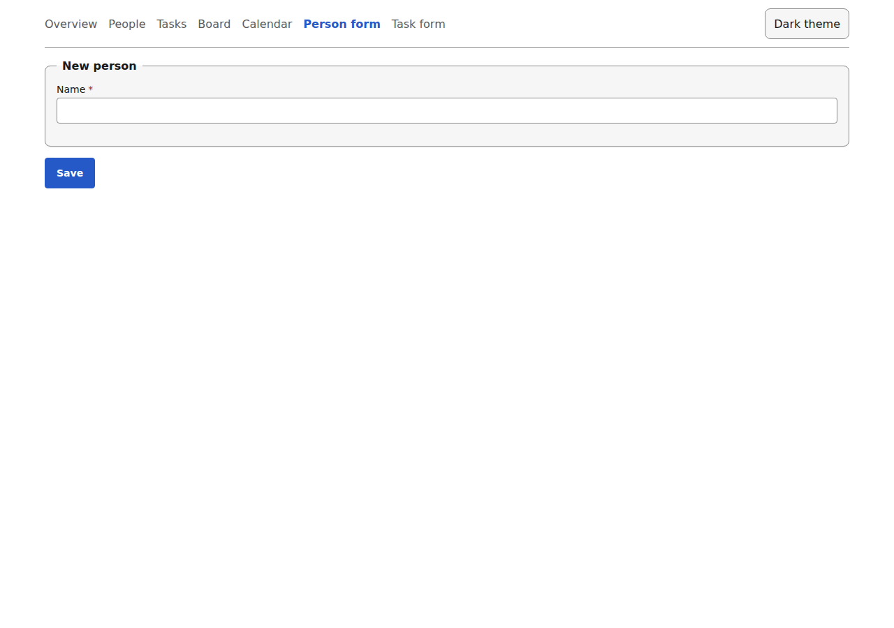
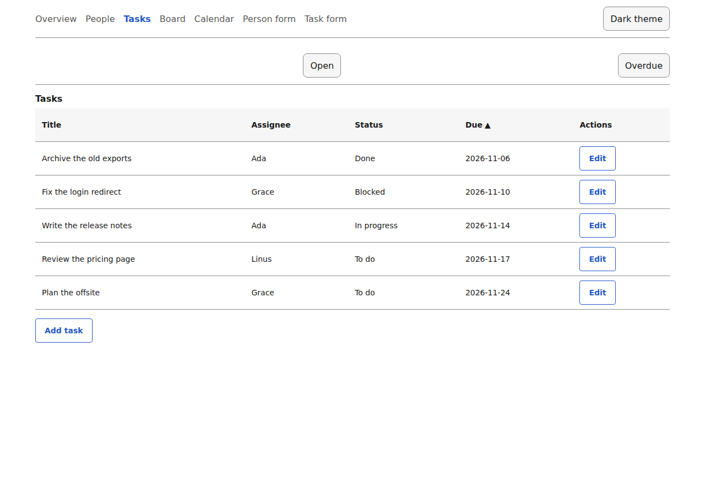
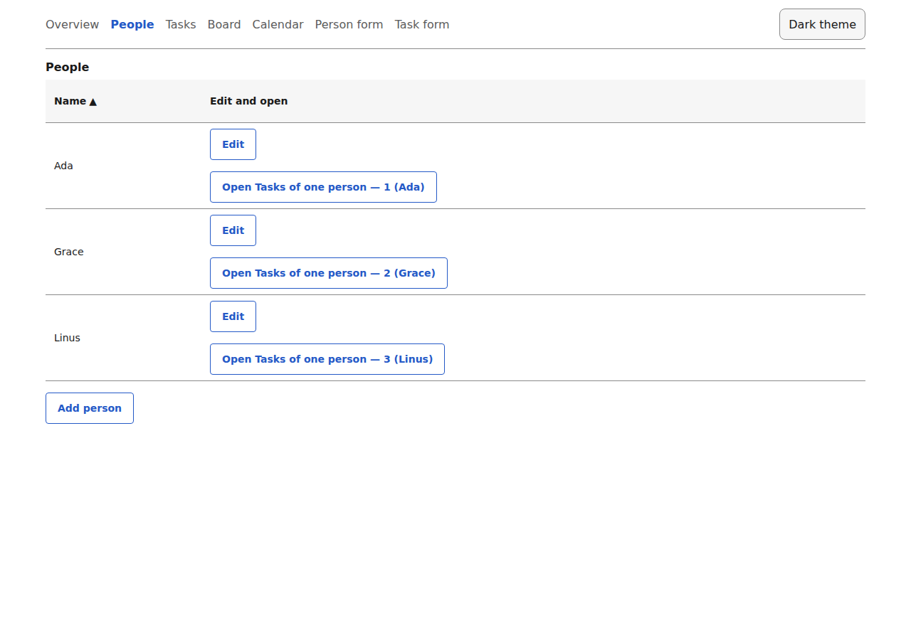
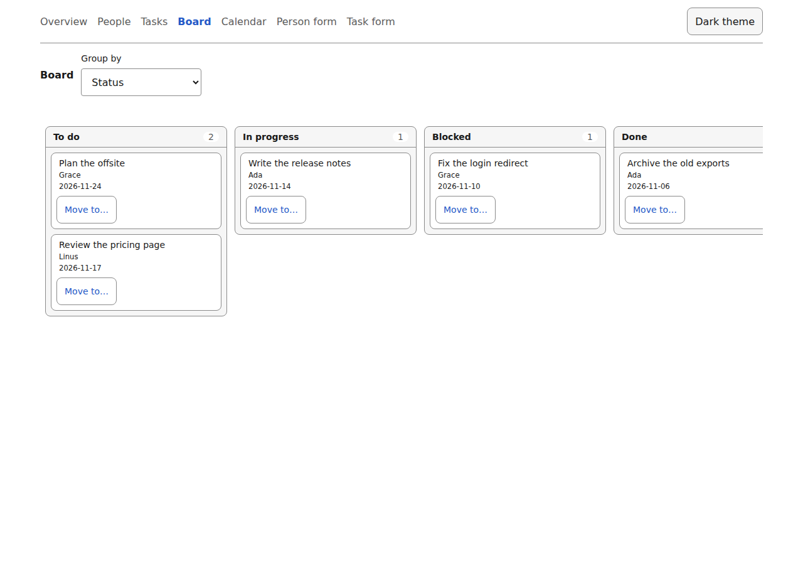
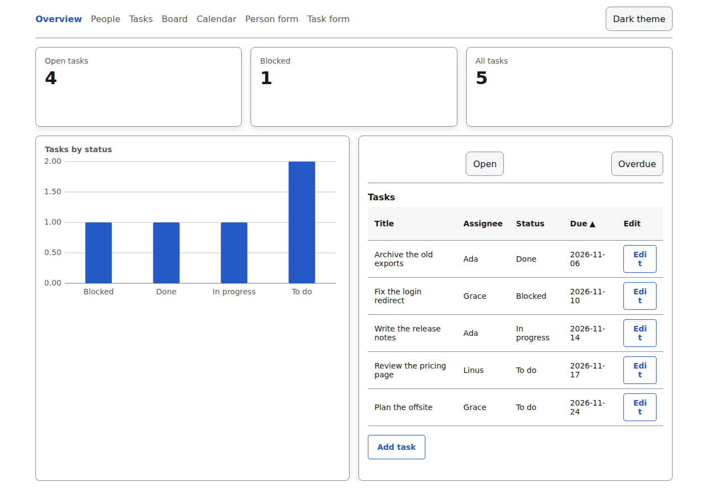

# Guide, part 1: from documents to a dashboard

This guide builds a small team-tasks app one document at a time. You end with a form, a table you can add to and edit, a board, a calendar, a dashboard and one rule that depends on who is looking. It uses an in-memory data source, so there is no backend yet. Part 2 puts a server behind the same app.

The app is the starter in [`examples/starter`](../examples/starter). Every file in this guide is quoted from it, and a test (`examples/starter/tests/guide.test.tsx`) fails when the guide and the starter drift apart. The only exceptions are the two files in step 6, which the starter does not have; the test checks those too.

You need Node 22.18 or newer and a checkout of this repository. The [toolchain table](../README.md#tested-with) lists what is tested.

## How the app works

A yadad app has three parts:

- **Documents.** JSON files that say what the data is (entities) and what each screen shows (views). They are the app.
- **A registry.** A set of components that draw the fields, tables and buttons. The starter uses `@yadad/components`. Documents never name a component.
- **A data source.** An adapter that loads and saves records. This guide uses `createMemoryAdapter`, which keeps records in the browser and forgets them on reload.

The renderers read the documents, ask the registry for components and ask the data source for records. Read [ARCHITECTURE.md](../ARCHITECTURE.md#5-runtime-model-two-inputs-two-writers) for the full picture.

## Step 0: set up the starter without its documents

Install and start the starter on the in-memory data source:

```sh
pnpm install
pnpm --filter @yadad/example-starter dev:memory
```

Open the address Vite prints. You see the finished app. To build it up yourself, move its documents aside. They come back with `git checkout examples/starter/documents`:

```sh
cd examples/starter
mv documents documents.final && mkdir documents
```

The host code stays. It is short, and it is why adding a file adds a screen. The starter's `src/main.tsx` puts the theme on the page and checks the documents before it draws anything:

<!-- excerpt: src/main.tsx -->
```tsx
const style = document.createElement("style");
style.textContent = themeToCss(lightTheme) + themeToCss(darkTheme, "[data-theme=dark]");
document.head.append(style);
```

That `<style>` tag is not optional. The components read `--yadad-*` variables, and without them the page is unstyled and nothing says why. The next lines check every document:

<!-- excerpt: src/main.tsx -->
```tsx
const result = validateDocuments(documents);
if (!result.ok) {
  // An invalid document shows its errors instead of the app.
```

`src/documents.ts` loads every file in `documents/` and builds the navigation from the views it finds:

<!-- excerpt: src/documents.ts -->
```ts
const files = import.meta.glob("../documents/*.json", { eager: true, import: "default" });
```

And `src/App.tsx` hands each view to the renderer for its kind:

<!-- excerpt: src/App.tsx -->
```tsx
  switch (view.kind) {
    case "form":
      // After a save the checklist hangs off the saved record (a sub-record needs a parent).
      return <FormRenderer entity={entity} view={view} {...shared} {...(saved ? { parent: saved } : {})} onSaved={setSaved} />;
    case "table":
      return <TableRenderer entity={entity} view={view} {...shared} reloadKey={saves} onChanged={bump} {...(filter ? { savedFilter: filter } : {})} onSavedFilterChange={setFilter} />;
```

The rest of this guide only adds files to `documents/`. Keep the dev server running and watch the page.

## Step 1: entities, and a first form

An **entity** is the data model: its fields, their types and their rules. Views can only make the rules stricter, never looser. Start with two entities, a person and a task. The task has a `reference` field that points at a person, and a `select` field with a fixed list of choices. See the [document reference](reference.md#entity-and-field-types) for every field type.


<!-- step 1: documents/person.json -->
```json
{
  "kind": "entity", "specVersion": 10, "id": "person", "revision": 1,
  "fields": [
    { "id": "name", "type": "text", "label": "Name", "required": true }
  ]
}
```

<!-- step 1: documents/task.json -->
```json
{
  "kind": "entity", "specVersion": 10, "id": "task", "revision": 1,
  "fields": [
    { "id": "title", "type": "text", "label": "Title", "required": true },
    { "id": "assignee", "type": "reference", "label": "Assignee", "entity": "person", "display": "name" },
    { "id": "status", "type": "select", "label": "Status", "required": true,
      "options": { "source": "static", "values": ["To do", "In progress", "Blocked", "Done"] } },
    { "id": "due", "type": "date", "label": "Due" },
    { "id": "notes", "type": "text", "label": "Notes", "multiline": true }
  ]
}
```

Now the first screen. A **form** creates a record of one entity. It lists the fields it shows, in sections:


<!-- step 1: documents/person_form.json -->
```json
{
  "kind": "form", "specVersion": 10, "id": "person_form", "entity": "person", "revision": 1, "dataSource": "default",
  "sections": [{ "id": "main", "title": "New person", "items": [{ "field": "name" }] }]
}
```

The page now has one screen, a form for a new person. Leave the name empty and press Save: the form says the field is required, because the entity says so. Type a name and save, and the person is stored (in memory, until you reload).



## Step 2: a task form and a table

A task can have a checklist of steps. A step is its own record, so it is a second entity that points back at its task:


<!-- step 2: documents/subtask.json -->
```json
{
  "kind": "entity", "specVersion": 10, "id": "subtask", "revision": 1,
  "fields": [
    { "id": "task", "type": "reference", "label": "Task", "entity": "task", "display": "title", "required": true },
    { "id": "title", "type": "text", "label": "Step", "required": true },
    { "id": "done", "type": "boolean", "label": "Done" },
    { "id": "position", "type": "number", "label": "Position", "min": 0 }
  ]
}
```

The task form uses two rules. `requiredWhen` makes Notes required only while the status is Blocked. The `subRecords` section is the checklist: each step is a `subtask` record whose `task` field names the task. A new task has no record yet, so the checklist appears once the task is saved. The starter's `App.tsx` passes the saved record to the form as its `parent`.


<!-- step 2: documents/task_form.json -->
```json
{
  "kind": "form", "specVersion": 10, "id": "task_form", "entity": "task", "revision": 1, "dataSource": "default",
  "sections": [
    { "id": "details", "title": "Task", "items": [
      { "field": "title" },
      { "field": "assignee" },
      { "field": "status" },
      { "field": "due" },
      { "field": "notes", "requiredWhen": { "op": "eq", "field": "status", "value": "Blocked" } }
    ] },
    { "id": "checklist", "title": "Checklist",
      "subRecords": { "entity": "subtask", "via": "task", "titleField": "title", "doneField": "done", "orderField": "position", "addLabel": "Add step" } }
  ]
}
```

A **table** lists the records of one entity. Its columns can be editable in place, `addForm` adds an "add" button that opens a form over the same entity, and `editForm` gives each row an edit button that opens that record in a form. The saved filters are chips the viewer can switch; which chip is lit is the host's state, and the starter keeps it in `App.tsx`.


<!-- step 2: documents/tasks.json -->
```json
{
  "kind": "table", "specVersion": 10, "id": "tasks", "title": "Tasks", "entity": "task", "revision": 1, "dataSource": "default",
  "columns": [
    { "field": "title", "editable": true },
    { "field": "assignee" },
    { "field": "status", "editable": true },
    { "field": "due", "editable": true }
  ],
  "sort": [{ "field": "due", "dir": "asc" }],
  "pageSize": 10,
  "addForm": "task_form",
  "editForm": "task_form",
  "filters": [
    { "id": "open", "name": "Open", "condition": { "op": "neq", "field": "status", "value": "Done" } },
    { "id": "overdue", "name": "Overdue", "condition": { "op": "and", "conditions": [
      { "op": "neq", "field": "status", "value": "Done" },
      { "op": "lt", "field": "due", "value": { "daysFromToday": 0 } }
    ] } }
  ]
}
```

Open the Tasks screen. The seed records are there. Press Edit on a row, change a status or a date and press Save: the table checks the edit against the entity and saves the changed fields. That is the quick edit, for the columns marked `editable`. Press "Edit" followed by a task's title to open the whole record in the task form (its notes and checklist too); the table gives way to the form, and Save or Back returns to it. Use Add to open the same form for a new task. Try the Open and Overdue chips.



## Step 3: drill from a row into another table

A table's `rowAction` opens another table from a row and fills that table's filter from the row. Here a click on a person opens the tasks of that person. The `bind` pairs a field of this row (`id`, the record's own id) with a field of the target table's entity (`assignee`).


<!-- step 3: documents/person_tasks.json -->
```json
{
  "kind": "table", "specVersion": 10, "id": "person_tasks", "title": "Tasks of one person", "entity": "task", "revision": 1, "dataSource": "default",
  "columns": [{ "field": "title" }, { "field": "status" }, { "field": "due" }],
  "sort": [{ "field": "due", "dir": "asc" }]
}
```

<!-- step 3: documents/people.json -->
```json
{
  "kind": "table", "specVersion": 10, "id": "people", "title": "People", "entity": "person", "revision": 1, "dataSource": "default",
  "columns": [{ "field": "name", "editable": true }],
  "sort": [{ "field": "name", "dir": "asc" }],
  "addForm": "person_form",
  "rowAction": { "open": "person_tasks", "bind": [{ "field": "id", "to": "assignee" }] }
}
```

The target table does not appear in the navigation: the starter hides every view that another view opens. Click a person to see their tasks.



## Step 4: a board and a calendar over the same entity

A **board** shows records as cards in columns, one column per value of a field. `groupBy` lists the fields the viewer can group by, and `editable` lets them drag a card to another column, which changes that field. A **calendar** places records on days by a date field, and dragging an entry to another day changes the date.


<!-- step 4: documents/board.json -->
```json
{
  "kind": "board", "specVersion": 10, "id": "board", "title": "Board", "entity": "task", "revision": 1, "dataSource": "default",
  "groupBy": [{ "field": "status" }, { "field": "assignee" }],
  "titleField": "title", "cardFields": ["assignee", "due"],
  "editable": true
}
```

<!-- step 4: documents/calendar.json -->
```json
{
  "kind": "calendar", "specVersion": 10, "id": "calendar", "title": "Calendar", "entity": "task", "revision": 1, "dataSource": "default",
  "dateField": "due", "titleField": "title", "colorField": "status", "editable": true
}
```

Neither view needed a new entity or any code. The board groups by status or by assignee; the calendar uses the due date and colours entries by status.



## Step 5: a dashboard

A **dashboard** is tabs of grid items, each with a position and size. This one has three counts, a chart and the tasks table itself. A `count` counts the records of a table view, with an optional extra `filter`. A `series` groups a table view by one field and draws one number per group, here as a bar chart. A `view` widget embeds another view by id. A dashboard never repeats a view; it points at it.


<!-- step 5: documents/overview.json -->
```json
{
  "kind": "dashboard", "specVersion": 10, "id": "overview", "title": "Overview", "revision": 1,
  "tabs": [{ "id": "main", "title": "Overview", "columns": 12, "items": [
    { "id": "open_count", "widget": "count", "label": "Open tasks", "view": "tasks",
      "filter": { "op": "neq", "field": "status", "value": "Done" }, "x": 0, "y": 0, "w": 4, "h": 2 },
    { "id": "blocked_count", "widget": "count", "label": "Blocked", "view": "tasks",
      "filter": { "op": "eq", "field": "status", "value": "Blocked" }, "x": 4, "y": 0, "w": 4, "h": 2 },
    { "id": "all_count", "widget": "count", "label": "All tasks", "view": "tasks", "x": 8, "y": 0, "w": 4, "h": 2 },
    { "id": "by_status", "widget": "series", "label": "Tasks by status", "view": "tasks",
      "groupBy": { "field": "status" }, "measure": { "op": "count" }, "display": "bar", "x": 0, "y": 2, "w": 6, "h": 8 },
    { "id": "tasks_view", "widget": "view", "view": "tasks", "x": 6, "y": 2, "w": 6, "h": 8 }
  ] }]
}
```



## Step 6: one rule that depends on who is looking

A **viewer** document declares facts about the person looking: a role, a plan, a flag. Views read them with `viewerIn`. Declare one fact, `role`, and make its default the least privileged value, because that is what a person gets when the host says nothing. The starter has no viewer document. Add this file:


<!-- new: documents/viewer.json -->
```json
{
  "kind": "viewer", "specVersion": 10, "id": "viewer", "revision": 1,
  "facts": [
    { "id": "role", "label": "Role", "type": "select", "default": "member",
      "options": { "source": "static", "values": ["member", "lead"] } }
  ]
}
```

Then change `documents/tasks.json` to add a Notes column that only a lead sees. This is the whole file with that one column added:


<!-- changed: documents/tasks.json -->
```json
{
  "kind": "table", "specVersion": 10, "id": "tasks", "title": "Tasks", "entity": "task", "revision": 1, "dataSource": "default",
  "columns": [
    { "field": "title", "editable": true },
    { "field": "assignee" },
    { "field": "status", "editable": true },
    { "field": "due", "editable": true },
    { "field": "notes", "visibleWhen": { "op": "viewerIn", "fact": "role", "values": ["lead"] } }
  ],
  "sort": [{ "field": "due", "dir": "asc" }],
  "pageSize": 10,
  "addForm": "task_form",
  "filters": [
    { "id": "open", "name": "Open", "condition": { "op": "neq", "field": "status", "value": "Done" } },
    { "id": "overdue", "name": "Overdue", "condition": { "op": "and", "conditions": [
      { "op": "neq", "field": "status", "value": "Done" },
      { "op": "lt", "field": "due", "value": { "daysFromToday": 0 } }
    ] } }
  ]
}
```

The table now hides the Notes column from everyone, because every viewer is a `member` by default. To let a person in as a lead, the host passes the viewer to the renderer. The renderers already find the viewer document through the `documents` prop; this call overrides the default with what the host knows:

```tsx
import { findViewerDocument, resolveViewer } from "@yadad/runtime";

const { viewer } = resolveViewer(findViewerDocument(documents), [{ fact: "role", value: "lead" }]);
// <TableRenderer ... viewer={viewer} />
```

The rule only changes what the screen offers. The server is the only authority on what a person may read or write, so it must never send data a viewer may not read. See the [records protocol](records-protocol.md).

## Step 7: check the documents, and what a mistake looks like

The starter shows validation errors instead of the app, so a mistake in a document is hard to miss. The same check runs from the command line, which is what a build or CI should run:

It is `ydcli validate` from the `@yadad/cli` package: it reads every JSON file in `documents/`, upgrades each to the current `specVersion`, validates the set together and exits non-zero on an error. The starter's `package.json` runs it as `ydcli validate documents`.

Run it:

```sh
pnpm --filter @yadad/example-starter check
```

Break a document on purpose. In `documents/tasks.json`, misspell the first column's field as `"titel"` and run the check again. This is the output of a real run:

<!-- output: check -->
```text
documents/tasks.json: /columns/0/field [unknown-reference] Field "titel" is not on entity "task".
```

The first part is the file, the second is a JSON Pointer to the exact place (the first column's `field`), then the error code and a message that says what is wrong. In the browser, the same error replaces the app until you fix it. Every error also carries a `hint` that says what to do. Fix the spelling and the check prints `OK`.

Two more checks are worth adding when the app grows. `validateDocuments` checks one set at a time, so run it on everything. And `checkViewStates` from `@yadad/testing/state-checks` renders every view in every state it can be in (empty, full, loading, failed, refused, as each viewer) and names what breaks. The starter's `tests/views.test.tsx` shows both.

# Guide, part 2: put a backend behind the app

Part 1 kept records in the browser. Here the same app talks to a server. The server is the starter's `server/index.ts`, about 240 lines of Node with SQLite. It implements the [records protocol](records-protocol.md), the HTTP contract that yadad's data adapter speaks. Any language works: a backend that answers the requests below gets the form, tables, board, calendar and dashboard with no more UI code.

Every request and response in this part is real. A test (`examples/starter/tests/guide.test.tsx`) starts the starter's server, drives it with yadad's own HTTP adapter and compares the traffic with the text here, so a change in the adapter, the server or the protocol fails the test until the guide is updated.

## Step 8: swap the adapter

Restore the finished documents if you were building them up (`rm -r documents && mv documents.final documents`), then start the app with its server:

```sh
pnpm --filter @yadad/example-starter dev
```

That starts the server on port 8787 (a SQLite file, seeded once) and Vite, which sends `/api` to it. The only host change from part 1 is the adapter. The starter picks it in `src/adapter.ts`:

<!-- excerpt: src/adapter.ts -->
```ts
export const createAdapter = () =>
  import.meta.env["VITE_DATA"] === "memory" ? createSeededAdapter() : createHttpAdapter({ baseUrl: "/api/records" });
```

The base URL is host configuration. It is never part of a document, and documents never contain a URL. The adapter calls `fetch` with `credentials: "same-origin"`, so session cookies work and no CORS is needed.

## What every request looks like

- The entity is the first part of the path: `/api/records/{entity}` where `{entity}` is the entity document's `id` (`task`, `person`). A record is `/api/records/{entity}/{id}`.
- Bodies are JSON in both directions.
- **Ids are opaque strings** that the server picks. The client never parses or builds one, and an id is never reused for another record, even after a delete (the starter uses SQLite `AUTOINCREMENT`).
- Every record has a `version`, also an opaque string. It must change on every write to the record. The client sends it back to say "I edited the record I loaded", and the server uses it to refuse a write to a record that changed since.
- Every non-2xx answer has the same body: `{ "errors": [{ "path", "code", "message", "hint" }] }`. `path` is a JSON Pointer into the request body, `code` is one of `type`, `required`, `unknown-property`, `invalid-value`, `not-found`, `conflict`, `unauthorized` or `forbidden`, and `message` and `hint` are for a person.

## Create

The form sends the values it collected and the entity revision it was built against. The server validates, picks an id, sets the version and answers `201` with the whole record:

<!-- exchange: create-person -->
```http
POST /api/records/person
Content-Type: application/json

{
  "values": {
    "name": "Ada"
  },
  "entityRevision": 1
}

HTTP/1.1 201
Content-Type: application/json

{
  "id": "1",
  "entityId": "person",
  "entityRevision": 1,
  "version": "1",
  "values": {
    "name": "Ada"
  }
}
```

<!-- exchange: create-task -->
```http
POST /api/records/task
Content-Type: application/json

{
  "values": {
    "title": "Write the release notes",
    "status": "In progress",
    "assignee": "1",
    "due": "2026-11-20"
  },
  "entityRevision": 1
}

HTTP/1.1 201
Content-Type: application/json

{
  "id": "2",
  "entityId": "task",
  "entityRevision": 1,
  "version": "1",
  "values": {
    "title": "Write the release notes",
    "status": "In progress",
    "assignee": "1",
    "due": "2026-11-20"
  }
}
```

A second task, which the list below shows:

<!-- exchange: create-task-2 -->
```http
POST /api/records/task
Content-Type: application/json

{
  "values": {
    "title": "Plan the offsite",
    "status": "To do",
    "due": "2026-12-01"
  },
  "entityRevision": 1
}

HTTP/1.1 201
Content-Type: application/json

{
  "id": "3",
  "entityId": "task",
  "entityRevision": 1,
  "version": "1",
  "values": {
    "title": "Plan the offsite",
    "status": "To do",
    "due": "2026-12-01"
  }
}
```

Nothing else is needed from the server for this to work: the form closes, the table reloads, the new row is there. The `entityRevision` is a stamp. The server stores it on the record and never rejects a write because it is old or new.

**When the values are wrong**, the answer is `400` with one error per problem. The adapter turns the `path` into the field, so the form shows each message under its field:

<!-- exchange: create-invalid -->
```http
POST /api/records/task
Content-Type: application/json

{
  "values": {
    "title": "Fix the login redirect",
    "status": "Someday",
    "assignee": "99"
  },
  "entityRevision": 1
}

HTTP/1.1 400
Content-Type: application/json

{
  "errors": [
    {
      "path": "/values/status",
      "code": "invalid-value",
      "message": "\"Someday\" is not a choice for \"Status\".",
      "hint": "Use one of: To do, In progress, Blocked, Done."
    },
    {
      "path": "/values/assignee",
      "code": "invalid-value",
      "message": "Assignee points at a person that does not exist.",
      "hint": "Pick an existing one."
    }
  ]
}
```

Both errors point into the request body: `/values/status` and `/values/assignee`. The client checks the rules before it sends, so a `400` for a value the entity allows means the server is stricter, or it checks something the client cannot, such as the second error here: a reference to a record that does not exist.

## Read one record

<!-- exchange: find-one -->
```http
GET /api/records/task/2

HTTP/1.1 200
Content-Type: application/json

{
  "id": "2",
  "entityId": "task",
  "entityRevision": 1,
  "version": "1",
  "values": {
    "title": "Write the release notes",
    "status": "In progress",
    "assignee": "1",
    "due": "2026-11-20"
  }
}
```

A record that does not exist is `404`, and so is a record that belongs to another user:

<!-- exchange: find-missing -->
```http
GET /api/records/task/99

HTTP/1.1 404
Content-Type: application/json

{
  "errors": [
    {
      "path": "",
      "code": "not-found",
      "message": "No such task.",
      "hint": "Reload the list."
    }
  ]
}
```

## List: paging, sort and filter

A table asks for a page, sorted and filtered. The query string carries three things:

- `offset` and `limit`: where the page starts and how many records. `limit` defaults to 50 and is at most 500; more than 500, or anything that is not a whole number, is `400`.
- `sort`: URL-encoded JSON, an array of `{ "field", "dir" }`, first key first. Records with an empty value sort last in both directions.
- `filter`: URL-encoded JSON, one condition from the document language: `eq`, `neq`, `gt`, `gte`, `lt`, `lte`, `in`, `contains`, `empty`, `notEmpty`, and `and`, `or`, `not` around them. The condition is data, never a string of code.

The answer is `{ "items": [...], "total": n }`. `total` counts every record that matches the filter, ignoring the page, so the table can show how many pages there are.

<!-- exchange: list -->
```http
GET /api/records/task?sort=%5B%7B%22field%22%3A%22due%22%2C%22dir%22%3A%22asc%22%7D%5D&offset=0&limit=10

HTTP/1.1 200
Content-Type: application/json

{
  "items": [
    {
      "id": "2",
      "entityId": "task",
      "entityRevision": 1,
      "version": "1",
      "values": {
        "title": "Write the release notes",
        "status": "In progress",
        "assignee": "1",
        "due": "2026-11-20"
      }
    },
    {
      "id": "3",
      "entityId": "task",
      "entityRevision": 1,
      "version": "1",
      "values": {
        "title": "Plan the offsite",
        "status": "To do",
        "due": "2026-12-01"
      }
    }
  ],
  "total": 2
}
```

The `sort` here decodes to `[{"field":"due","dir":"asc"}]`. A filter, on top of that, decodes to `{"op":"eq","field":"status","value":"To do"}`:

<!-- exchange: list-filtered -->
```http
GET /api/records/task?filter=%7B%22op%22%3A%22eq%22%2C%22field%22%3A%22status%22%2C%22value%22%3A%22To%20do%22%7D&sort=%5B%7B%22field%22%3A%22due%22%2C%22dir%22%3A%22asc%22%7D%5D&offset=0&limit=10

HTTP/1.1 200
Content-Type: application/json

{
  "items": [
    {
      "id": "3",
      "entityId": "task",
      "entityRevision": 1,
      "version": "1",
      "values": {
        "title": "Plan the offsite",
        "status": "To do",
        "due": "2026-12-01"
      }
    }
  ],
  "total": 1
}
```

**Translate filters by whitelist.** For every operator and field id in the filter, check that you know it and map it to your storage yourself (the starter's `toSql` does this). Never build a query from the strings in the request. An unknown operator or field is `400`. Relative dates such as "7 days ago" never reach the server: the client turns them into a concrete date first. A `viewerIn` condition is for documents, not for the wire, and is also `400`.

## Update

An edit sends only the fields that changed, and the version of the record it loaded as `baseVersion`:

<!-- exchange: update -->
```http
PATCH /api/records/task/2
Content-Type: application/json

{
  "values": {
    "status": "Done"
  },
  "entityRevision": 1,
  "baseVersion": "1"
}

HTTP/1.1 200
Content-Type: application/json

{
  "id": "2",
  "entityId": "task",
  "entityRevision": 1,
  "version": "2",
  "values": {
    "title": "Write the release notes",
    "status": "Done",
    "assignee": "1",
    "due": "2026-11-20"
  }
}
```

The server applies the patch, writes a new version and answers with the whole record. An omitted field is unchanged, and an explicit `null` clears one. `baseVersion` is required on an update.

**When the record changed since it was loaded**, the server answers `409` and includes the record as it is now, in `current`. The client shows the conflict and reloads. Here a second edit still carries version `1`, but the first one made it `2`:

<!-- exchange: update-stale -->
```http
PATCH /api/records/task/2
Content-Type: application/json

{
  "values": {
    "status": "Blocked"
  },
  "entityRevision": 1,
  "baseVersion": "1"
}

HTTP/1.1 409
Content-Type: application/json

{
  "errors": [
    {
      "path": "/baseVersion",
      "code": "conflict",
      "message": "This task was changed since you loaded it.",
      "hint": "Reload it and try again."
    }
  ],
  "current": {
    "id": "2",
    "entityId": "task",
    "entityRevision": 1,
    "version": "2",
    "values": {
      "title": "Write the release notes",
      "status": "Done",
      "assignee": "1",
      "due": "2026-11-20"
    }
  }
}
```

Check `baseVersion` before anything else. A write with a stale `baseVersion` is a `409` even when its values are also invalid, because the values were built against a record that no longer exists in that form. Only a write with a current `baseVersion` gets a `400` for bad values.

## Delete

`baseVersion` goes in the query string and is optional. When it is there and stale, the answer is `409` as for an update. A successful delete answers `204` with no body:

<!-- exchange: delete -->
```http
DELETE /api/records/task/3?baseVersion=1

HTTP/1.1 204
```

## What the server must enforce itself

The client's checks are a convenience that saves a round trip. The server is the only authority.

- **Validate every write.** Do not rewrite the field rules. Generate a JSON Schema from the entity document with `recordJsonSchema(entity, { mode: "write" })` from `@yadad/core`, or call `validateRecord` from `@yadad/runtime` as the starter does:

<!-- excerpt: server/index.ts -->
```ts
    const errors: Err[] = validateRecord(entity, values, { mode: "write" }).map((e) => ({ path: prefix + e.path, code: e.code, message: e.message, hint: e.hint ?? "" }));
```

- **Check references.** A schema cannot tell whether the referenced record exists. The second error in the invalid create above came from the starter's own check.
- **Refuse unknown fields.** An unknown field id in `values` is `400`, never silently dropped.
- **Own the rules the document does not know.** The server may be stricter than the entity (a date that must be near the server's today). The server is the authority on "today".
- **Permissions.** Who may read or write which record is the server's alone. Documents never say it.

## What each record can say about the viewer: `can`

A record may carry `can`, what the person making the request may do with it. The UI then offers only what is allowed:

<!-- record-with-can -->
```json
{
  "id": "2",
  "entityId": "task",
  "entityRevision": 1,
  "version": "2",
  "values": { "title": "Write the release notes", "status": "Done" },
  "can": { "update": false, "delete": false, "fields": { "status": false } }
}
```

With this record the table offers no edit, and a board does not let the status be moved. `can` only restricts: a missing `can`, or a missing key in it, means "not stated", the UI offers the action and the server decides on the write. The starter does not send `can`. `update`, `delete`, `actions` and `fields` are the keys. A server that sends it must still refuse the write with `403`.

## What you may skip at first

| Skip | What the app does without it |
| --- | --- |
| `total` in a list answer | A page with neither `total` nor `next` is treated as the last page, so a table cannot tell there is more, and a count widget has nothing to read. Send it as soon as you can |
| `limit=0` support | A count widget asks for `limit=0` to read the total. A server that refuses it leaves the widget saying it could not load. `limit=0` is legal: empty `items`, and the real `total` |
| `can` on records | The UI offers every edit; the server refuses what is not allowed |
| `POST /{entity}/_batch` | A form with `repeat: "batch"` fails to save its rows with the server's `404` message. Everything else works |
| `POST /{entity}/{id}/actions/{action}` | An entity's record actions (a Done or Archive button) fail with the server's `404` message when pressed. Tables, forms and boards work |
| Cursor paging | Only needed for a server that cannot count. Offset and limit are enough |

The starter implements create, read, list, update and delete, with `total`, and skips the rest. Read the [records protocol](records-protocol.md) when you need batches or actions.

## Sign-in, scoping and CSRF

**The starter server has no authentication.** Anyone who can reach the port can read and change every record. A real backend identifies the person from its own session, never from anything the client says: the client sends no user id. It scopes every query to what that person may see (another person's record is a `404`), and it protects cookie-authenticated writes against cross-site requests (for example `SameSite` cookies, or checking the content type). The adapter has an `onUnauthorized` hook for a `401`, which is the place to send a person to a sign-in page. [docs/security.md](security.md) lists what the engine does and what the server must do.


## Where to go next

- Put your own documents in a copy of the starter: its README has the steps to take it out of the repository.
- [Document reference](reference.md): everything a document can contain, with an example of each kind.
- [ARCHITECTURE.md](../ARCHITECTURE.md): the design, section by section.
