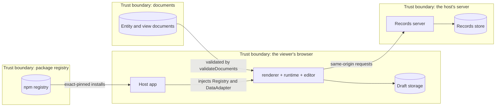
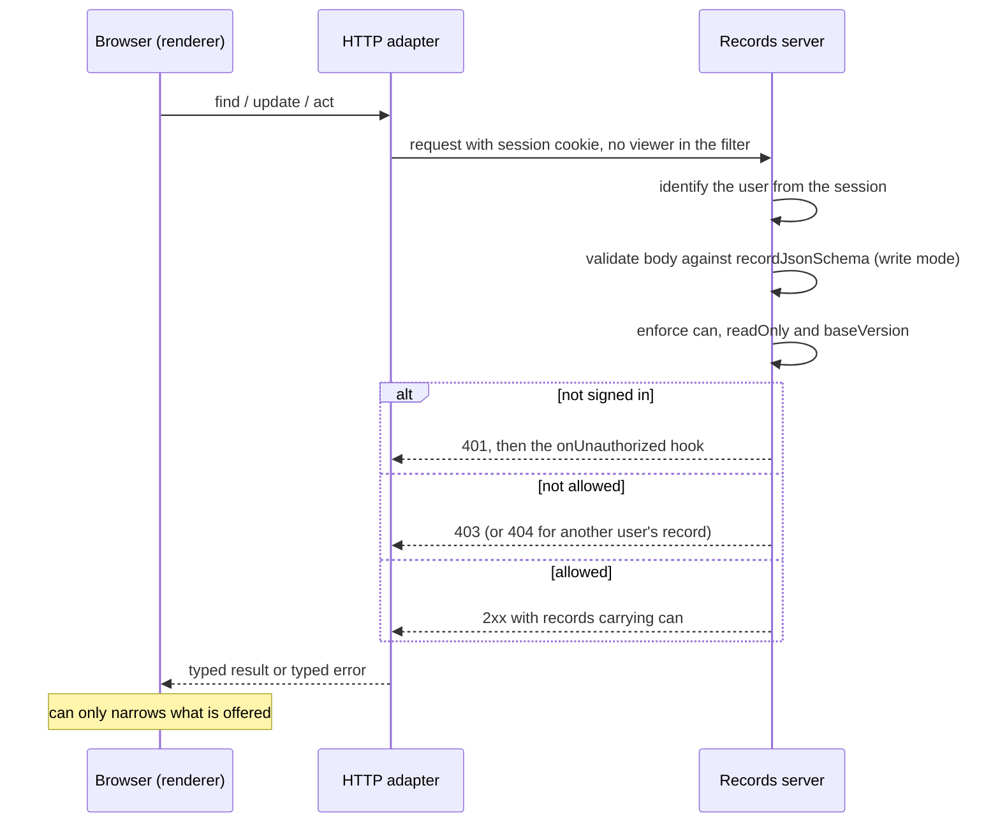
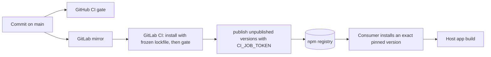

# Security

The engine is a client-side library plus a protocol. It holds no secrets and runs no server of its own, so most of this page is about what a host and its records server must do, and what the engine does to make the safe path the easy one. Every claim was checked against the code at 99c6244 (2026-10-27). Gaps are marked **open**; this page documents them and fixes none.

## 1. Trust boundaries

The browser is untrusted from the server's point of view: whatever the renderer hides, the server must refuse again. Documents are data the engine validates before use. The registry is trusted only as far as the pinned versions go. Checked against `docs/records-protocol.md`, `packages/runtime/src/http-adapter.ts` and `tools/release/publish.sh`, 99c6244.

## 2. Authentication and authorisation

The engine does not authenticate anyone. The host's server does, usually with a session cookie, and the HTTP adapter sends that cookie by sending requests with `credentials: "same-origin"`.

What decides what a request may do: the server's own session and rules. The record's `can` is server output that the client uses to hide or disable controls; documents' viewer predicates (RFC 0006) do the same from host-supplied facts. Neither can enable anything the server refuses. A filter never carries the viewer (`viewerIn` is refused client-side and is an unknown op on the wire). Checked against `docs/records-protocol.md` and `packages/runtime/src/http-adapter.ts`, 99c6244.

### What the engine guarantees

- **Authority stays on the server (RFC 0006).** Documents and `can` only narrow what is offered; no document verb grants access.
- **A document cannot run code.** There are no string expressions, no free-form props and no `custom` field types (AGENTS.md rule 5); conditions are a closed AST.
- **Text is rendered as text.** `git grep -n "dangerouslySetInnerHTML\|innerHTML" -- packages testing apps` is empty at this commit.
- **Colours are checked against the palette.** `validateDocuments` flags an option colour outside `COLOR_PALETTE`. Today that is a warning, not an error (D50), so a stray colour paints nothing rather than being rejected.
- **The built app makes no requests to yadad infrastructure.** The only network call in the packages is the HTTP adapter's `fetch` to the host's configured base URL; no telemetry or remote URL appears in `packages/*/src` or the showcase source.

### What a records server must do

These are the protocol's server obligations (`docs/records-protocol.md`):

1. Validate every write's `values` against `recordJsonSchema(entity, { mode: "write" })`, and refuse a `readOnly` field.
2. Enforce `can` itself: stating `update: false` is not enforcement. Return 403 for a refused write.
3. Check `baseVersion` first and answer 409 with `current`.
4. Translate filters by whitelist; an unknown op or field is a 400. Never build a query from request strings.
5. Scope records to the signed-in user on the server; another user's record is a 404.

## 3. Data the app holds

| Data | Personal or sensitive | Where it lives | Who can read it |
| --- | --- | --- | --- |
| Documents (entities, views) | No by design; they describe shape | The host's document store | Whoever the host lets load them |
| Records | Whatever the host's fields hold | The host's records store, behind the server | The server's authorisation rules |
| Unsent form drafts | Can hold anything typed into a form | Browser storage under `yadad:draft:<view>:<record or "new">` (`createDraftStore`) | Scripts and users of that browser profile; not cleared on sign-out by the engine |
| Showcase records | Sample data | Memory, or `localStorage` under the showcase prefix | The local browser |
| Viewer facts | A role or plan label | Host memory, passed as a prop | The page |

The engine has no server-side storage and no analytics. Checked against `packages/runtime/src/drafts.ts`, `key-value-adapter.ts` and `apps/showcase/src/App.tsx`, 99c6244.

## 4. Secrets inventory

The engine holds none. These are the secrets its release process uses; names only.

| Secret | Where it lives | What uses it | Rotation |
| --- | --- | --- | --- |
| `CI_JOB_TOKEN` | Issued per job by GitLab CI | `tools/release/publish.sh` writes it to a temporary `~/.npmrc` inside the job to publish | Automatic: expires with the job |
| Registry read credentials for consumers | The consumer's own `.npmrc` (a user-level file, not in this repo) | Installing `@yadad/*` from the GitLab registry | By the registry owner; not documented here (**open**: no written rotation schedule) |
| Mirror push credentials | The GitHub-to-GitLab push mirror's settings | Mirroring `main` so GitLab CI runs | By the repo owner; not documented here (**open**) |

Hosts and their records servers keep their own secrets (session keys, database credentials); those belong in the host's security page.

## 5. Threats and mitigations

| Category | Threat | Mitigation that exists | Status |
| --- | --- | --- | --- |
| Spoofing | A request passes as another user | Identity is the server's session; the client sends no user id and no `viewerIn` | Server-owned |
| Spoofing | A look-alike package in the install path | The registry scope `@yadad` is mapped to one registry; consumers pin exact versions | Partly: **open**, no signature or provenance check |
| Tampering | A hand-edited document grants itself power | Documents are validated and only narrow; no expressions | Mitigated |
| Tampering | A write overwrites a newer change | `baseVersion` and 409 `current` | Mitigated |
| Tampering | A write sets a server-owned field | `validateRecord` refuses `readOnly`; the server must too | Mitigated if the server follows the protocol |
| Tampering | Cross-site request forgery against cookie-authenticated writes | Same-origin requests, JSON bodies | **open**: the protocol does not state the server's CSRF duty (for example SameSite cookies or a content-type check) |
| Information disclosure | Hidden fields or rows still sent to the browser | `can` and viewer predicates only hide | **open** by design: the server must not send what the viewer may not read; the protocol says so only for `can` |
| Information disclosure | Another user's draft left in browser storage | Drafts are keyed by view and record only | **open**: not keyed by user, not cleared on sign-out |
| Information disclosure | Script injection reads data | Text is rendered as text; no `innerHTML` in the engine | Mitigated in the engine; the component set is a separate repo |
| Denial of service | A huge page or filter | `limit` max 500, `400` on bad paging; the server whitelists ops | Server-owned |
| Denial of service | A hostile document with deep nesting | `validateDocuments` runs before render | **open**: no documented depth or size limit |
| Elevation of privilege | A client calls an action it was not offered | The server enforces `can.actions` and returns 403 | Server-owned |
| Elevation of privilege | A compromised dependency runs in the host | Exact pins, `pnpm install --frozen-lockfile` in CI | Partly: **open**, see section 6 |

## 6. Supply chain and deploy

Pinning happens at two points: the lockfile is frozen when CI installs, and consumers pin exact versions. Signing does not happen anywhere: packages carry no provenance attestation and no signature (**open**). Publishing runs `pnpm install --frozen-lockfile` and the gate before it publishes. There is no automated dependency-audit step in CI (**open**). Checked against `.gitlab-ci.yml`, `tools/release/publish.sh` and `.github/workflows/ci.yml`, 99c6244.
