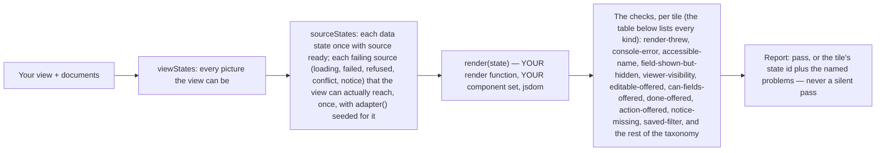
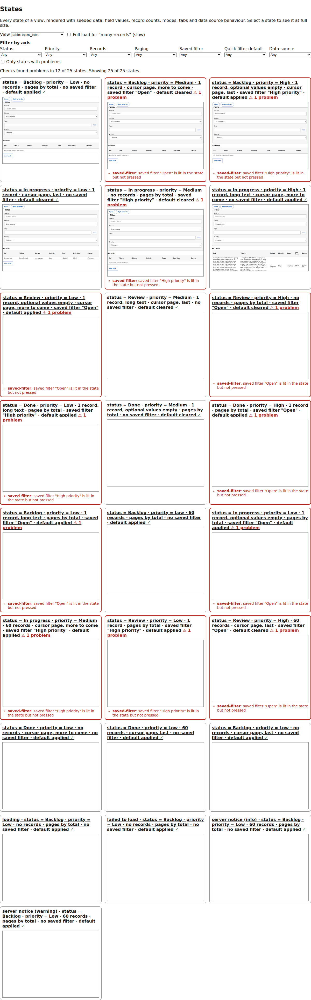

# @yadad/testing

Test support for yadad: a mock registry and the registry contract test kit. Use it to test code that renders yadad documents without a real component set, or to prove that your own component set satisfies the `Registry` contract.

A built yadad app makes no requests to yadad infrastructure: all data comes from the `DataAdapter` the host supplies.

```sh
npm install --save-dev @yadad/testing
```

Peer dependencies: React 19, `react-dom`, `vitest` and `jsdom`.

The package has four entry points. Import only the one you need:

| Entry point | Who needs it | What it needs |
| --- | --- | --- |
| `@yadad/testing` | An app or a renderer: the mock registry, source states, `createStateAdapter`, `waitForSettled` | Nothing beyond React; no DOM of its own |
| `@yadad/testing/state-checks` | An app that wants every state of its views checked (`checkViewStates`) | A DOM (jsdom) and Vitest |
| `@yadad/testing/contract-kit` | A component set: proves it satisfies the `Registry` contract, and runs the record-action scenarios | A DOM (jsdom) and Vitest |
| `@yadad/testing/focus-kit` | A component set or renderer: proves focus lands in the right place after a record action | A DOM (jsdom) and Vitest |

## Mock registry

`mockRegistry` (a `Registry<ReactNode>`) has an unstyled stub component for every field type, layout piece and widget, each with a `data-testid` hook.

```tsx
import { render, screen } from "@testing-library/react";
import { FormRenderer } from "@yadad/renderer";
import { mockRegistry } from "@yadad/testing";

render(<FormRenderer entity={entity} view={form} registry={mockRegistry} dataSources={dataSources} />);
```

## Wait for loads

A view loads its rows asynchronously, so an assertion made right after `render` or a save can run before they are drawn. Wait with the helpers instead of a timeout:

```tsx
import { waitForRows, waitForSettled } from "@yadad/testing";

const { container } = render(<TableRenderer ... />);
const rows = await waitForRows(container, { view: "log", count: 3 }); // exactly 3 rows, nothing busy
await waitForSettled(container); // nothing under the container reports busy
```

`waitForSettled` waits until no element reports `aria-busy="true"`, a loading quick filter or the series loading marker. `waitForRows` also waits for the view's rows (table rows, board cards and calendar entries of the mock registry; pass `rowSelector` for another registry) and resolves with them. `view` limits it to one view's id; `count` makes it wait for exactly that many.

## Source states

A screen has states that come from the data source: still loading, failed to load, a save refused, a conflict, a notice from the server. `createStateAdapter(seed, options)` returns a `DataAdapter` seeded with a view state's records (from `viewStates` in `@yadad/runtime`) or with a list of records, and puts it in one of them.

```ts
import { createStateAdapter } from "@yadad/testing";

const adapter = createStateAdapter(state, { source: "refused", status: 400, field: "title", message: "Title is taken." });
adapter.configure({ source: "ready" }); // switch while the test runs
```

- `source: "ready"` (default) works like the memory adapter.
- `"loading"`: `find` and `findOne` never settle.
- `"error"`: reads reject with an `Error` carrying `message`.
- `"refused"`: writes throw a `RecordValidationError` with one field error (400, the default, pointing at `field`) or a `ForbiddenError` (`status: 403`).
- `"conflict"`: writes throw a `RecordConflictError` (409) carrying the stored record.
- `"notice-info"` and `"notice-warning"`: a working source whose list answers carry a `notice` (`{ tone: "info" | "warning", text }`), the text being `message`. Writes work as normal. A server uses a notice to say something about one answer, for example that it was served without search. Every view that lists records gets these two states. The `notice-missing` check reads them: it fails when the text is not in a `role="status"` region, or the region shows another tone.

`act` works on every source: the same guard order as the memory adapter (unknown record, then stale `baseVersion`, then the source's refusal), then a no-op — the record comes back unchanged. A confirm dialog and its failure states are testable without a server.

`sourceStates(viewStates(view, documents, { now }), documents)` adds a `source` axis to the view's data states. Every data state stays once with `source: "ready"`; each other source that makes sense for the view (a save can only be refused or conflict where the view writes) gets one state. Each state has `adapter()`, a fresh adapter seeded with its records and put in its source state.

## What a state-check run covers

`checkViewStates` is `viewStates` plus the adapter's side of life, rendered with *your* components:



The showcase's States page is the same machinery on screen — every state of `tasks_table`, the data-source states included, checks reported beside each tile:



*Each tile renders one state through the host's own `render`; a tile that throws, logs an error, shows a field the conditions hide, lacks an accessible name or offers a forbidden edit is reported by name, not silently passed. A run of the grid — named files: `testing/src/state-checks.tsx` for the checks, `packages/runtime/src/view-states.ts` for the states.*

## Check every state of your views

One browser check covers one state. `checkViewStates` from `@yadad/testing/state-checks` renders **every** state of a view (its data states, then the source states above) and reports the ones that break. It needs a DOM and Vitest: use it in a test file with `// @vitest-environment jsdom`.

You pass a `render` function that returns your renderer for the state, so the wiring is one line per view kind. `testing` never imports a renderer itself.

```tsx
// @vitest-environment jsdom
import { readFileSync } from "node:fs";
import { validateDocuments } from "@yadad/core";
import { BoardRenderer, CalendarRenderer, DashboardRenderer, FormRenderer, TableRenderer, documentSet } from "@yadad/renderer";
import { mockRegistry } from "@yadad/testing";
import { checkViewStates, problems } from "@yadad/testing/state-checks";
import type { CheckViewStatesOptions } from "@yadad/testing/state-checks";
import { expect, test } from "vitest";

// This page's slice: its entity, its views, at most one viewer — the same documents the real page loads.
const raw: unknown[] = ["task.json", "task_form.json", "task_table.json", "task_board.json", "task_dashboard.json"].map((f) => JSON.parse(readFileSync(`./docs/${f}`, "utf8")));
const checked = validateDocuments(raw); // validate each page's slice, not just the whole pile at boot
if (!checked.ok) throw new Error(checked.errors.map((e) => `${e.document ?? "?"}: ${e.message}`).join("\n"));
const documents = checked.value;
const set = documentSet(documents); // entities + views + viewer by id — what tables, boards, dashboards and row actions need

const render: CheckViewStatesOptions["render"] = (state, { view, entity, registry, dataSources, drafts, now, viewer, omitViewer }) => {
  const who = omitViewer ? {} : { viewer }; // a view that reads viewer facts: pass the state's viewer, or none on the "viewer not provided" state
  switch (view.kind) {
    // A form state's values arrive through the draft store — pass `drafts` or the form renders empty.
    case "form": return <FormRenderer entity={entity!} view={view} registry={registry} dataSources={dataSources} entities={set.entities} documents={set} {...(drafts ? { drafts } : {})} {...who} />;
    case "table": return state.render.kind === "table" ? <TableRenderer entity={entity!} view={view} registry={registry} dataSources={dataSources} entities={set.entities} documents={set} savedFilter={state.render.savedFilter} {...who} /> : null;
    // The state names the mode and the day the calendar opens on; key remounts it per state so the seed applies.
    case "calendar": return state.render.kind === "calendar" ? <CalendarRenderer key={state.id} entity={entity!} view={view} registry={registry} dataSources={dataSources} entities={set.entities} documents={set} now={now} initialMode={state.render.mode} initialAnchor={state.render.anchor} {...who} /> : null;
    // The state names the grouping; the viewer can still switch after the state seeds it.
    case "board": return state.render.kind === "board" ? <BoardRenderer key={state.id} entity={entity!} view={view} registry={registry} dataSources={dataSources} entities={set.entities} documents={set} initialGroupBy={state.render.groupBy} {...who} /> : null;
    case "dashboard": return state.render.kind === "dashboard" ? <DashboardRenderer key={state.id} dashboard={view} documents={set} registry={registry} dataSources={dataSources} initialTab={state.render.tab} {...who} /> : null;
  }
};

test.each(["task_form", "task_table", "task_board", "task_dashboard"])("%s, in every state", async (id) => {
  const results = await checkViewStates({ view: id, documents, registry: mockRegistry, now: new Date(2026, 9, 15), render });
  expect(results.length).toBeGreaterThan(0);
  expect(problems(results)).toEqual([]);
});
```

### Upgrading hand-written drivers

**0.12 and later.** A `render` function must pass the state's `state.render` keys to the renderer: `state.render.savedFilter` to `TableRenderer`'s `savedFilter`, and likewise `mode` and `anchor` (calendar), `groupBy` (board), `tab` (dashboard), `rows` (batch form, to `initialRows`) and `quickDefaults` (table quick filters). A driver that ignores `savedFilter` fails the `saved-filter` check on every table with named `filters`, because the table never applies the filter the state selected.

**0.13.1 and later.**
- A `readOnly` field keeps its `field:<id>` axis when a view condition references it (so a condition on a server-set field is still exercised), and has none otherwise.
- States that used to be skipped silently are now generated and checked: labelled select values, and entities with a `readOnly` value (including a server-set `required` + `readOnly` id). Expect new failures on upgrade; they are real.
- The calendar `done-missing` check counts only the entries a day cell draws, so a calendar with `maxEntriesPerDay` no longer needs the check skipped.

**Loud skips.** A state the grid cannot build is no longer silent. A skip whose cause is a grid fault (a generated record that fails validation, no records could be generated) fails with the check `grid-fault`; `problems(results)` lists it. Expect new `grid-fault` failures on upgrade: they are real grid or validator bugs, so report them rather than skipping the check. Declared limits (a dashboard cannot embed a dashboard, a view not among the documents, a series over a non-table) stay skips. The report lists every skip in `skippedStates` (`{ id, reason, kind }`), and the option `maxSkipped` fails the report with `too-many-skipped` when the limit-skip count exceeds it.

**What state checks don't check.** The checks render your component tree against the mock adapter, so they can't see: which `dataSource` key a view names (every key serves the same seeded adapter — a wrong key renders green here and empty in the app); what a real server serves or refuses (the adapter is seeded, not queried); and anything after a write (saving, actions, optimistic refresh). Cover those with adapter tests against your real data source and end-to-end tests.

`checkViewStates({ view, documents, render, now, registry?, limit?, embeddedLimit?, manyRecords?, skip?, maxSkipped?, settleMs?, timeoutMs? })` takes the view (or its id) and every document it needs, and returns one `{ id, label, problems }` per state. `render(state, context)` gets the `SourceViewState` and a context with `view`, `entity`, `documents`, `registry` (defaults to the mock registry), `adapter` and `dataSources` (the state's seeded adapter, under every data source key), `drafts` (for a form state: a draft store holding the state's values; pass it to the form), `now`, `viewer` (the state's resolved viewer) and `omitViewer` (true on the "viewer not provided" state: leave the renderer's `viewer` prop out entirely). A dashboard state on a later tab is opened for you by clicking its tab.

Above `limit` the grid is a pairwise cover, not every combination: a green run then proves every *pair* of values appears somewhere, not every state. Ask what it covered with `checkViewStatesReport` — same options, and `checkViewStates` is exactly its `results`:

```tsx
import { checkViewStatesReport, problems } from "@yadad/testing/state-checks";

const report = await checkViewStatesReport({ view: id, documents, registry: myRegistry, now: new Date(2026, 9, 15), render });
expect(problems(report.results)).toEqual([]);
expect(report.complete).toBe(true); // false: limit cut the grid short — this run covered a sample
// report.strategy: "full" | "pairwise" · report.states: how many states rendered (size test timeouts by it)
// report.axes: the ids the grid varied along (data axes, then "source") · report.skipped: how many states were left out · report.skippedStates: each one's id, reason and kind ("fault" fails the run, "limit" is a declared limit)
```

`expectAxes: ["permission", "records", ...]` fails the run when a listed axis is absent from the grid: a view that quietly loses its last editable column loses its `permission` axis — and every locked-record state with it — while staying green, so name the axes the view must cover and let the check catch the refactor. Each missing id adds one `axis-missing` problem (naming the axis and the view) to the first result; `skip: ["axis-missing"]` leaves it out.

Checks per state, each a named problem:

| Check | Fails when |
| --- | --- |
| `render-threw` | `render`, or the first reads settling, throws |
| `console-error` | React or the renderer calls `console.error` |
| `yadad-warning` | the renderer warns with a `yadad:` message (only the renderer's own warnings; others pass through) — pass the render function the **same** `entities` the real page passes, or a reference column warns for its missing target |
| `field-shown-but-hidden` / `field-missing` | a form shows a field whose `visibleWhen` is false, or lacks one whose is true (fields are found by the control `id` ending in `-<fieldId>`, which every `inputId` does) |
| `required-marker` | a field's required marker (`required`, `aria-required` or a `*` in its label) disagrees with `required` and `requiredWhen` |
| `accessible-name` | a button, link, input or other interactive element has no accessible name (axe) |
| `error-message` | a source that fails to load shows no message |
| `group-by-ignored` | a board state is grouped by one field but the rendered board uses another |
| `mode-ignored` / `anchor-ignored` | a calendar state is in one mode, or on one month or week, but the rendered calendar shows another |
| `viewer-visibility` | a dashboard tab or table column is shown, or missing, against what the state's viewer may see |
| `editable-offered` | an inline edit, move or open handler is offered where the viewer condition is false or the record is locked |
| `editable-missing` | the reverse: it is withheld where the viewer may use it |
| `action-offered` | a table, calendar or board offers a record action the state withholds (`can.actions` false or `visibleWhen` false) |
| `action-missing` | the reverse: an action `availableActions` allows is not offered |
| `diff-offered` | a text column's Display was given a `diff` although the column does not compare |
| `diff-missing` | a comparing column's Display got no `diff` while its comparator is present |
| `can-fields-offered` | a calendar entry or board card can be moved although the record's `can.fields` withholds the field the move writes (or the record is locked) |
| `can-fields-missing` | the reverse: the record's `can.fields` leaves that field open, but the entry or card cannot be moved |
| `done-offered` | a card or entry shows a completion toggle but the view has no `doneField`, or the toggle's checked or disabled state disagrees with the stored value and the viewer's rights |
| `done-missing` | the view declares `doneField` but a card or entry got no toggle, a toggle is disabled although the viewer may write the field, or fewer checkboxes are drawn than toggles wanted |
| `saved-filter` | a saved filter (the view's `filters`) has no chip, or its chip's `aria-pressed` disagrees with whether the state lit it |
| `sort-offered` | a column declared unsortable (`sortable: false` on the column or the view) has a header that offers sorting |
| `sort-missing` | the reverse: a sortable column's header does not offer sorting (reference columns never sort) |
| `quick-default` | a quick filter's `default` is not what its control shows when defaults are applied, or the control still shows it after the state cleared it |
| `notice-missing` | in a `notice-info` or `notice-warning` state, the server's text is in no `role="status"` region, or its tone differs from `data-tone` |
| `axis-missing` | an id in `expectAxes` is absent from the grid (added to the first result, not per state) |
| `grid-fault` | the grid itself could not build a state because of a bug (for example a generated record fails validation). Report it rather than skipping the check |
| `too-many-skipped` | more states were skipped by a declared limit than `maxSkipped` allows (added to the report, not per state) |

`problems(results)` flattens the results into one line per problem, `"<state label> [<state id>]: <check>: <message>"`, so a failing `expect(problems(...)).toEqual([])` lists every failing state. Pass `timeZone` to have generated `datetime` values rendered in a zone other than UTC (it goes to `viewStates`; a datetime quick-filter state then compares against 09:30 in that zone). `skip: ["accessible-name"]` leaves a check out. `limit` caps the data states (24 by default); lower `manyRecords` to keep the "many records" states fast.

## Contract kit

Import it from `@yadad/testing/contract-kit` in a Vitest file. For every field type, the kit checks that your component renders with fixture options, emits the right JSON type on change, shows an error it is given, and passes axe; the layout components get their own checks.

```tsx
import { describeRegistryContract } from "@yadad/testing/contract-kit";
import { myRegistry } from "./registry";

describeRegistryContract(myRegistry);
```

- `registryContractChecks(registry, samples?)` returns the checks as `{ name, run() }` objects, for use outside Vitest. Run them one at a time.
- `defaultSamples` is the fixture per field type; pass your own `FieldSamples` to override them.
- The `layout.Calendar`, `layout.Board` and `layout.Dialog` keys, the `widgets.series` key and the `fields.datetime` key are optional, so their checks only run when the registry has them. `layout.Dialog` is checked for the modal behaviour RFC 0007 needs: named by its label, focus taken on open and returned on close, Escape closes. `fields.datetime` is checked for a `<time>` element whose `dateTime` is the stored instant, showing the formatted `text` it was given. `widgets.series` is checked the way a chart must be: reachable by its label as an accessible name, every group's label and formatted text present as text in the accessible tree (an SVG of bars is decoration, not data), the `measureLabel` shown, and no throwing or self-unmounting on `groups: []` or a gap bucket whose `value` is undefined. The mock registry ships all of them (a plain board with a "Move to…" action and no drag, a datetime input over `datetime-local`, a minimal dialog, a series as a plain table of groups) and passes the kit.

## Action scenarios

The contract kit also runs scenarios for record actions, through the one line of wiring you give it. An action is a command a record can run (a Publish button, an Archive that asks first). The scenarios prove what a press does:

- pressing an action runs it, announces it and reloads the row, and only that record changes;
- a confirm is asked before the action runs, and Cancel closes the dialog without running it;
- a confirm with `subjectField` names the record it acts on;
- the dialog validates its input, keeps itself open when the input is wrong, then answers the action with the input;
- a refused action (403) closes the dialog and reports through the view;
- acting on a stale record (409) reports the conflict and reloads.

You pass `mount`, which renders the host's table over the adapter the kit gives you, and the `registry` under test. The kit never imports a renderer. This sample is copied from `packages/renderer/src/action-scenarios.test.tsx`, which runs in the engine's own tests:

```tsx
// @vitest-environment jsdom
import { mockRegistry } from "@yadad/testing";
import { describeActionScenarios } from "@yadad/testing/contract-kit";
import { TableRenderer } from "./table-renderer.js";

describeActionScenarios({
  registry: mockRegistry,
  mount: ({ entity, view, registry, adapter }) => <TableRenderer entity={entity} view={view} registry={registry} dataSources={new Map([["default", adapter]])} />,
});
```

`actionScenarioChecks({ mount, registry })` returns the same scenarios as `{ name, run() }` objects, for use outside Vitest. Run them one at a time.

## Focus contract kit

Import it from `@yadad/testing/focus-kit` in a Vitest file with `// @vitest-environment jsdom`. The action scenarios prove what a press DOES; this kit proves where focus LANDS after it — the property F18 found by hand, six times, reading `document.activeElement` after every press. The kit seeds two records (Publish mutates in place; Archive confirms with a required Reason), presses record-action controls and asserts where focus ends up. It never imports a renderer: the host injects `mount`, exactly as in `describeActionScenarios`.

```tsx
// @vitest-environment jsdom
import { describeFocusContract } from "@yadad/testing/focus-kit";

describeFocusContract({
  registry: myRegistry,
  mount: (ctx) => <TableRenderer entity={ctx.entity} view={ctx.view} registry={ctx.registry} dataSources={new Map([["default", ctx.adapter]])} />,
});
```

The five interaction shapes it asserts, and the timing pair, are listed on `describeFocusContract`'s JSDoc: direct action, panel action, dialog from panel, view-scoped lookup (the same record mounted twice), id-changing move, plus armed-until-data-lands and no-steal with a deliberately slow reload.

- `focusContractChecks(options)` returns the checks as `{ name, run() }` objects, for use outside Vitest. Run them one at a time — like the contract checks, they share `document`.
- jsdom truth this kit is built around: `fireEvent.click` does not focus its target, so every press calls `control.focus()` first; and jsdom does not drop focus when the focused node is removed (a browser blurs it to `<body>`), so every check runs under the kit's own `withJsdomRemovalShim` — host test files never install it. Without it the drop-to-body half of the property is simply not tested, and an inert host passes the negative control vacuously.
- Capability gates, the way the optional registry keys gate the contract kit: a registry with no panel (nothing marked `data-yadad-focus-return`) yields ZERO panel checks, and no `layout.Dialog` key yields zero dialog checks — never a false failure. Pass `capabilities` to state a capability the probe cannot see; the kit's own tests assert both directions.
- The reserved attributes it reads (`data-yadad-record`, `data-yadad-record-view`, `data-yadad-focus-return`) are the renderer's own: any component set that wants the panel and view-scoped shapes must carry them.
- Negative control (Do step 5): `packages/renderer/src/focus-contract.test.tsx` mounts an inert host that never restores focus; every shape check must go red against it, so a check that only ever sees passing hosts cannot pass CI quietly. One honest exception: `focus timing (no-steal)` stays green — a host that never restores focus also never *steals* it, so only a restoring host can fail that check.

## How it fits

`testing` imports `core` and `runtime` only, so `renderer` and `editor` can use it in their tests without a cycle; `checkViewStates` takes the host's `render` function (see the [dependency graph](../ARCHITECTURE.md#4-dependency-rules) and the [state grid](../ARCHITECTURE.md#13-the-state-grid)).

See the [repo README](../README.md) and [ARCHITECTURE.md](../ARCHITECTURE.md).
